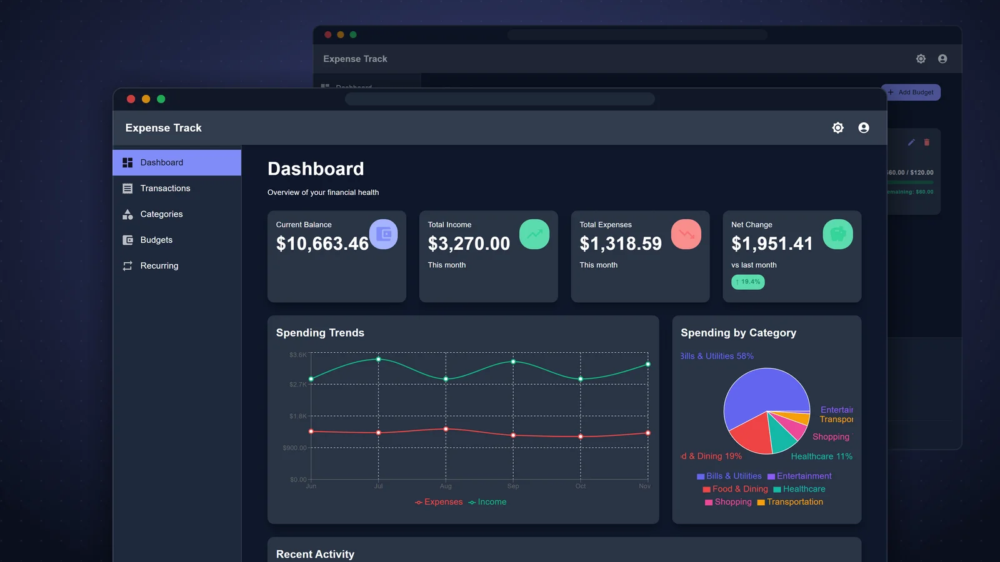

# Expense Tracker App

A modern, mobile-first personal finance application built with React, TypeScript, and Material UI. Track your income and expenses, visualize spending patterns, set budgets, and gain insights into your financial health.



## ✨ Features

- **Local-first** - Runs fully in the browser; data is saved in localStorage, no server or sign-up needed
- **Transaction Management** - Full CRUD operations for income and expenses
- **Categories** - Organize transactions with customizable categories
- **Dashboard** - Visual overview of your financial health with charts
- **Budgets** - Set spending limits and track progress
- **Recurring Transactions** - Automate regular income/expenses
- **Filtering & Search** - Find transactions quickly
- **Dark Mode** - Toggle between light and dark themes
- **Mobile Responsive** - Optimized for all screen sizes with dedicated mobile navigation

## 🛠️ Tech Stack

### Frontend
- **React 19** - Modern React with hooks
- **TypeScript** - Strict type safety
- **Vite 8** - Fast build tool and dev server
- **Material UI 9** - Polished UI components
- **Tailwind CSS 4** - Utility-first styling
- **Recharts** - Interactive charts and visualizations
- **React Router 7** - Client-side routing
- **date-fns** - Date manipulation

### Storage
- **LocalStorage** - All data stays in the browser

## 🚀 Getting Started

### Prerequisites

- Node.js 18+ and npm

### Installation

1. Clone the repository
   ```bash
   git clone <repository-url>
   cd expense-tracker
   ```

2. Install dependencies
   ```bash
   npm install
   ```

3. Start the development server
   ```bash
   npm run dev
   ```

4. Open your browser and navigate to `http://localhost:5173`

### Available Scripts

- `npm run dev` - Start development server
- `npm run build` - Build for production
- `npm run preview` - Preview production build
- `npm run lint` - Run ESLint

## 📱 Features Overview

### Dashboard
View your financial summary with interactive charts showing income vs expenses, category breakdowns, and spending trends over time.

### Transactions
- Add, edit, and delete transactions
- Categorize income and expenses
- Filter by date range, category, or type
- Search transactions by description

### Budgets
- Set monthly, weekly, or yearly budgets per category
- Track spending against budget limits
- Visual progress indicators

### Recurring Transactions
- Automate regular bills and income
- Set frequency (daily, weekly, monthly, yearly)
- Automatic transaction creation

### Categories
- Customize categories with colors and icons
- Create categories for income, expenses, or both
- Default categories included

## 🎨 Design Features

- **Responsive Design** - Works seamlessly on desktop, tablet, and mobile
- **Dark Mode** - Light/dark toggle, remembered between visits
- **Material Design** - Clean, modern UI following Material Design principles
- **Accessibility** - ARIA labels and keyboard navigation support

## 📝 License

MIT License, see [LICENSE](LICENSE).

## 👨‍💻 Author
- **Created by Ezan M. Nebija** - [ezannebija.dev](https://ezannebija.dev)

---


**Portfolio Project** - Demonstrating clean architecture, TypeScript best practices, React patterns, and modern UI/UX design.
